<div align="center">


#  Rafiq · رفيق
### An Arabic-first AI agent for Windows that works on your own machine

[](https://github.com/AhmadALSaffan/RAFIQ/actions/workflows/ci.yml)
[](https://tauri.app/)
[](https://react.dev/)
[](https://www.typescriptlang.org/)
[](https://www.python.org/)
[](https://fastapi.tiangolo.com/)
[](#-getting-started)
[](#overview)
[](#)

<!--
### Website
[](https://YOUR-SITE-HERE)
-->

---
</div>

<div align="center">

https://github.com/user-attachments/assets/3da54706-52ca-4fb2-87bd-c5f5a4b4518c

</div>

---

## What's new · v0.5.9

<!-- Every release: replace docs/whats-new/latest.webp with the release's picture (the same
     one the app's What's new dialog shows) and update the version, points and link below. -->

<div align="center">

<a href="https://github.com/AhmadALSaffan/RAFIQ/releases/download/v0.5.9/app-board-ar.mp4">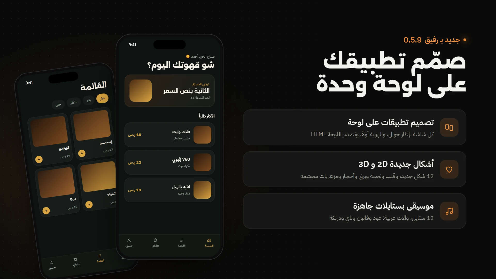</a>

<sub>The picture opens a 24-second video of the board (in Arabic).</sub>

</div>

**App design, on one board.** A new door in the creative hub: describe your app and its
screens come back on one board — the identity sheet first (logo, colours, type,
components), then every screen in a phone frame, in the order of the user's journey. A
button that leads to another screen takes the board there, and the whole board exports as
one HTML file that opens in any browser.
- **New shapes in motion:** twelve more in 2D, and 3D hearts, stars, bolts, gems and vases.
- **Music in ready styles:** twelve of them, with Arabic instruments (oud, qanun, ney, darbuka).
- **Eight new sound effects.**

Full notes: [v0.5.9](https://github.com/AhmadALSaffan/RAFIQ/releases/tag/v0.5.9) · every release: [Releases](https://github.com/AhmadALSaffan/RAFIQ/releases)

---

## Overview

**Rafiq** (Arabic for *companion*) is a Windows desktop app developed by [AhmadALSaffan](https://github.com/AhmadALSaffan). You connect the AI model you already use — Anthropic, OpenAI, Gemini, DeepSeek, a local Ollama model, and more — and Rafiq gives it real tools to work with on your machine: it reads and writes files, runs commands, writes Word documents in proper Arabic, designs interfaces with a live preview, and works on your issues in Jira, Linear, GitHub, GitLab and eight more trackers. Select text in any program and one shortcut translates, fixes or answers it.

The whole interface is Arabic and right-to-left from the ground up, everything runs locally, and nothing sensitive happens without your approval.

> 🔑 **Bring your own model:** Rafiq has no account system and no cloud of its own. You add an API key for the provider you choose (stored in Windows Credential Manager), sign in with a ChatGPT (Plus or Pro) or a GitHub Copilot account, or run a model locally with Ollama.

---

## Videos

<div align="center">

| Rafiq works on your issues | Select text anywhere · Word in Arabic | The welcome |
|:---:|:---:|:---:|
| [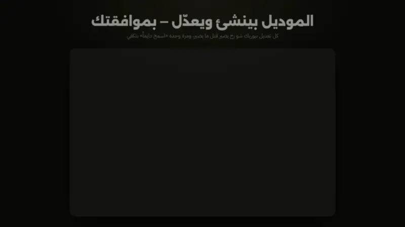](docs/videos/integrations.mp4) | [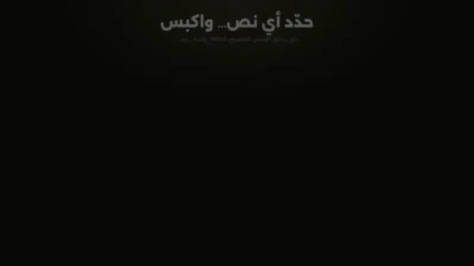](docs/videos/rafiq-0.5.mp4) | [](docs/videos/typewriter-dark.mp4) |
| 12 trackers; the model splits issues and starts tasks with your approval, and the issue moves from *To Do* to *In Review* with a branch and a pull request. **54 s** | Press Ctrl+Shift+Space over selected text: translate, fix, rephrase, summarise, reply — and Word documents that read right to left. **47 s** | The welcome's start button types itself out, and again on hover. **10 s** · [light](docs/videos/typewriter-light.mp4) |

<sub>Click a preview for the full video.</sub>

</div>

---

## Screenshots

<div align="center">

| Home | Chat |
|:---:|:---:|
| 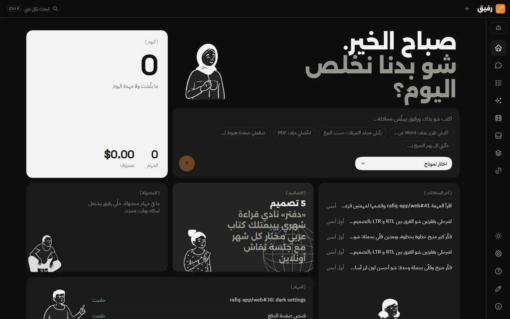 | 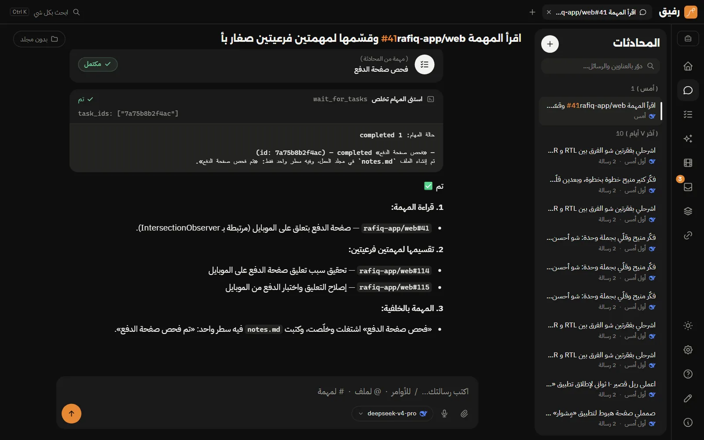 |
| How your day is going at a glance: today's tasks and spending, this month against its limit, recent chats, the next scheduled run, a world clock, and a box to start a chat — with ideas to start from — on the model you pick. | Stream a reply from any model you connected; a plan turns into tasks you can follow right in the chat. `/` commands, `@` for files and `#` for issues. |

| Tasks | One task, start to finish |
|:---:|:---:|
| 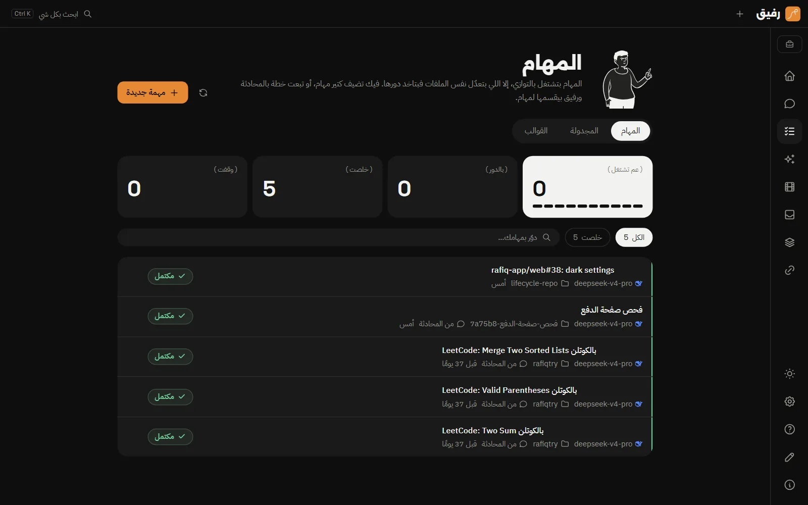 | 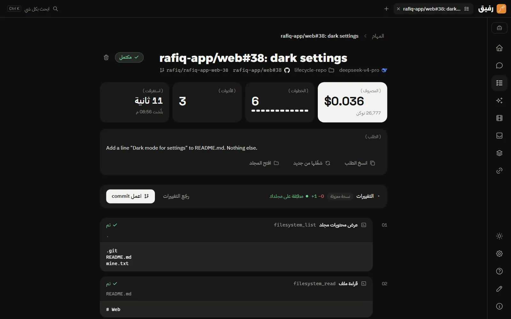 |
| Hand work off and watch it run: what's running, waiting, done or stopped, and every task one click away. | Every step numbered, every tool call and its output, and what the task cost. |

| Designs | Write your own skills |
|:---:|:---:|
| 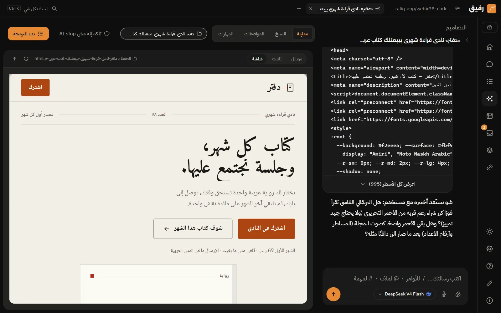 | 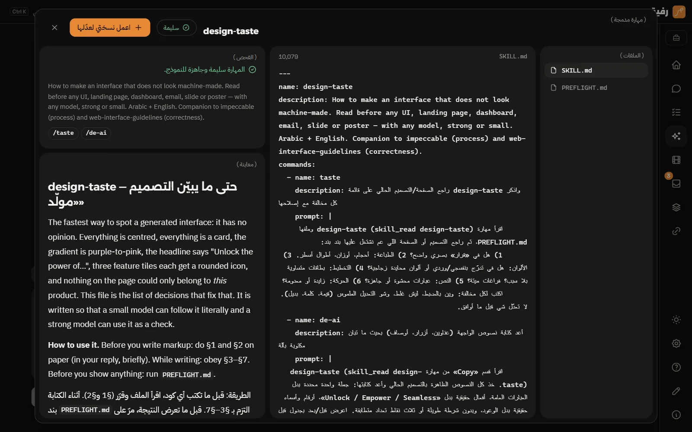 |
| Design the interface before you build it: a live preview beside the conversation that shaped it, with every version kept. | Write or edit a skill with its files and `/` commands; it's checked as you type and previewed as the model will read it. |

| Models | Cost |
|:---:|:---:|
| 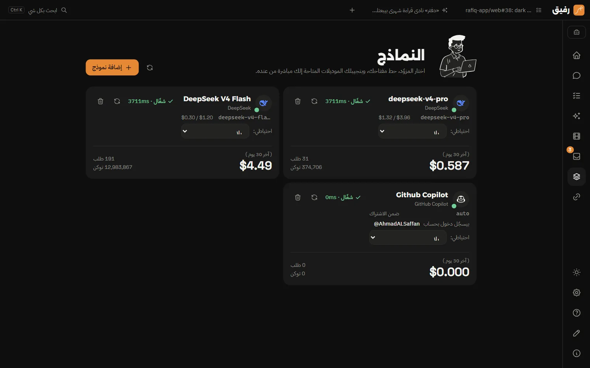 | 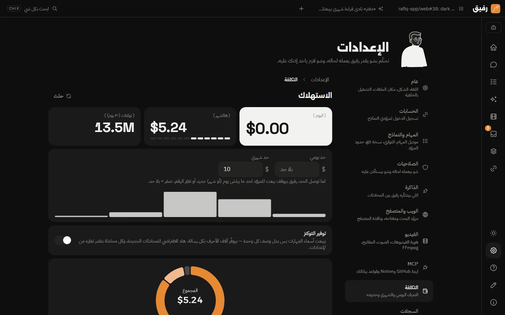 |
| Every model you connected, cloud or local, with its status, its fallback and what it cost over the last 30 days. | Today, this month and the tokens behind them, daily and monthly limits, and the spend of each model. |

| Schedules | All your designs |
|:---:|:---:|
| 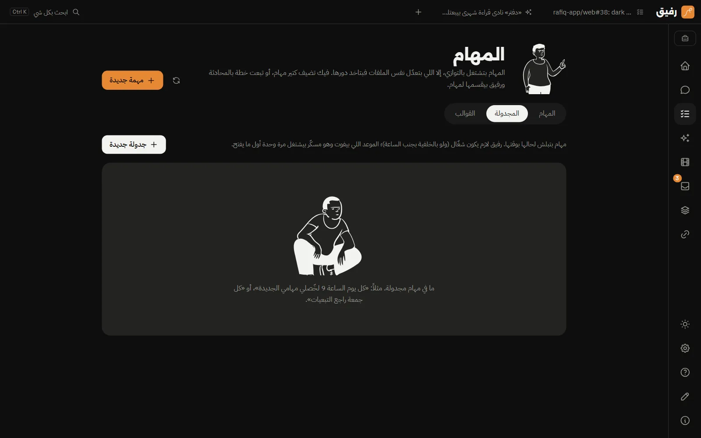 | 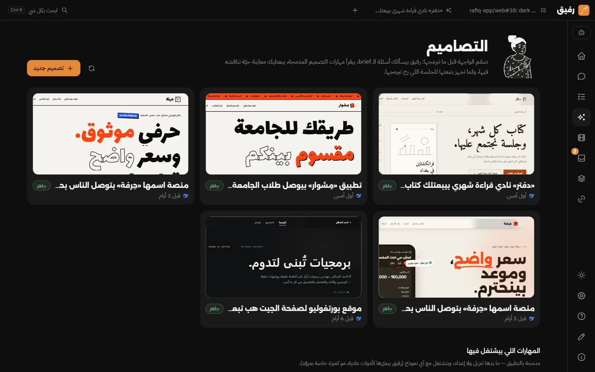 |
| Tasks that start on their own, every day, on chosen weekdays or every few hours, with the next run set large. | Every design as a live thumbnail, the skills the model designs with, and one click to install more. |

| Connections | Ctrl+K opens everything |
|:---:|:---:|
| 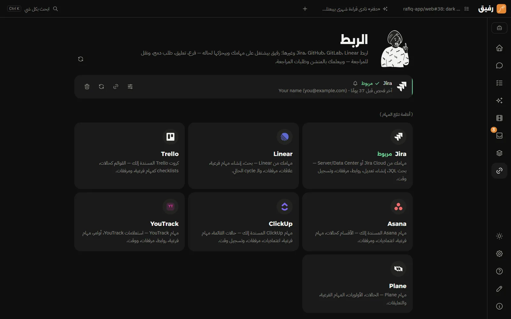 | 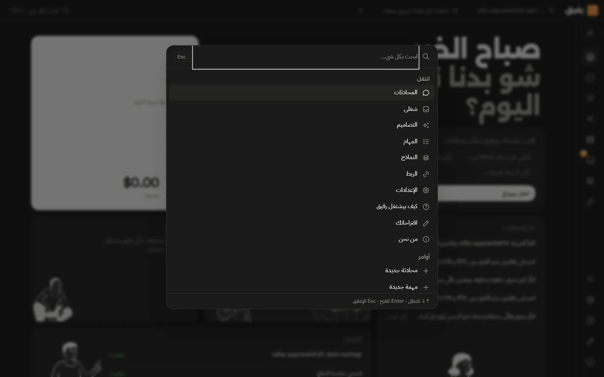 |
| Twelve issue trackers, connected once and brought into any chat with `#`; rules, notices, team channels and a log you can undo. | Every page, command, chat, task and design in one box, from anywhere in the app. |

| Settings | About |
|:---:|:---:|
| 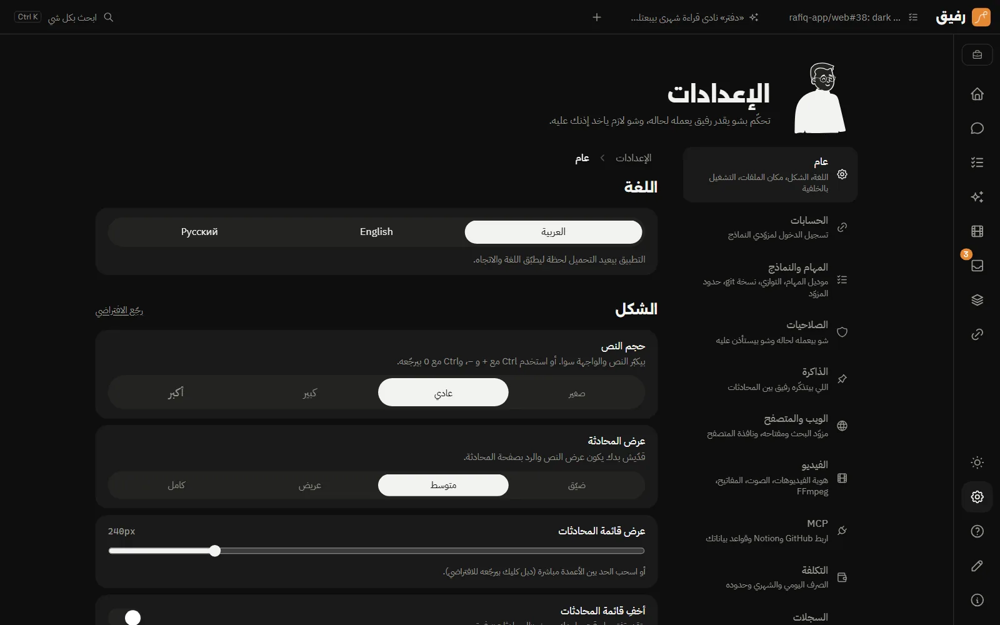 | 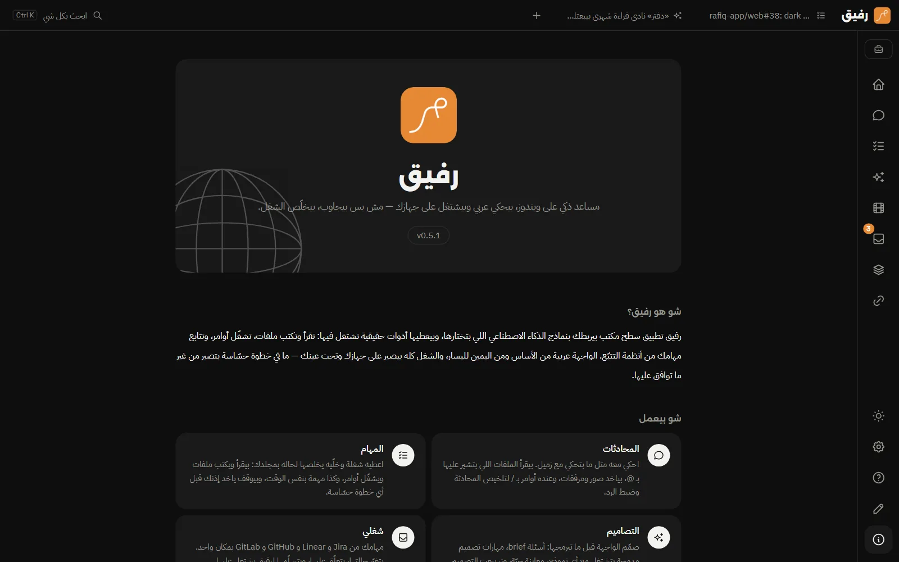 |
| Language, layout, the quick-ask shortcut and your own quick actions, backups, and every permission — with a path at the top. | What Rafiq is, what it can do, and who made it. |

| Suggestions | |
|:---:|:---:|
| 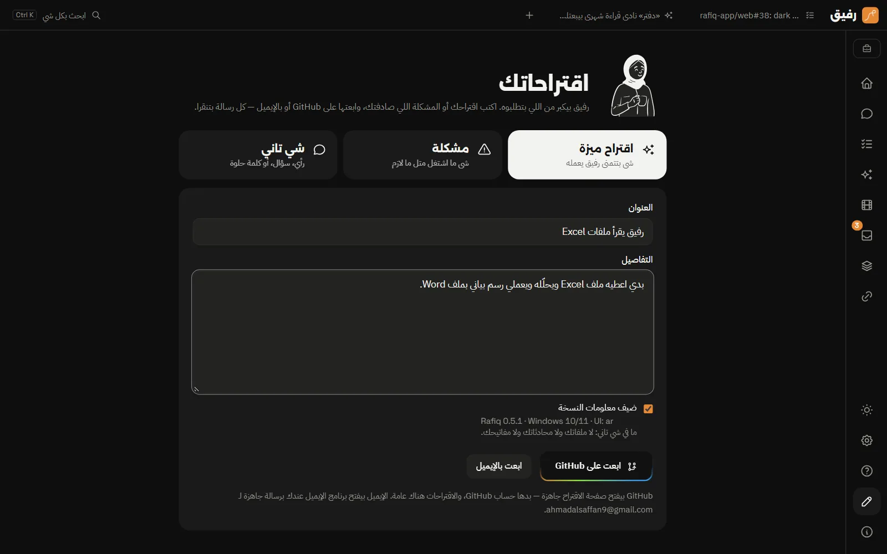 | |
| An idea or a problem, sent as a GitHub issue ready to post or as an email — nothing leaves until you send it. | |

<sub>Screenshots of Rafiq 0.5.1 in the dark theme; the app has a light theme too.</sub>

</div>

---

## Features

### New in 0.4.29 – 0.5.1

- ✂️ **Act on any selected text** — Select text in any program and press the quick-ask shortcut: the box opens on it with translate, fix, rephrase, summarise and reply, or a question about it. Rafiq copies with Ctrl+Insert (never interrupting a terminal) and puts your clipboard back as it was
- ⚡ **Your own quick actions** — "Make it formal", "Turn it into a tweet"… up to 20, beside the built-in ones (Settings → General)
- 📄 **Word documents in proper Arabic** — A `word_write` tool turns Markdown into a `.docx` that reads right to left: an Arabic font, tables read from the right, bullets on the right, and English kept in order inside Arabic
- 🔗 **Twelve trackers** — Jira, Linear, GitHub, GitLab, Azure DevOps, Trello, Asana, ClickUp, YouTrack, Bitbucket, Gitea and Plane; a code sign-in for GitHub and GitLab, and a read-only switch per account
- 🤖 **The model works on your issues, and asks first** — It reads, splits, creates, edits, links and comments on issues, and starts tasks and schedules of its own; every write shows a card with *Allow*, *Deny* and *Always allow*, kept in Settings → Permissions
- 🚦 **Issues that move with the task** — *In Progress* when a task starts, *In Review* or *Done* when it ends, on a branch named after the issue, with a commit, a push or a pull request that closes it
- 🗂️ **A Work page** — List and board (drag between columns), bulk changes, a side panel with the work Rafiq did, reviews, notices, saved views and Ctrl+N to create an issue
- 🔔 **Notices, rules and team channels** — Watch for assignments, mentions, reviews and comments; rules prepare a task or a plan for matching issues; Slack, Teams and Discord webhooks; every change on a tracker logged and undoable
- 💬 **Suggestions** — A page to send an idea or a problem as a GitHub issue ready to post, or as an email; nothing leaves until you send it
- 🏠 **A richer Home** — Ideas to start from, the model in a liquid menu, a departures-board world clock, this month's spending, and the quick-ask shortcut at a glance
- ⬆️ **Updates you can't miss** — When a new version is out, the app shows what's new and installs it before carrying on
- ✨ **A finer feel** — Skeletons while loading, a breadcrumb with a hover pill, a 404 page with digits that lean from the pointer, and an error screen instead of a blank window when a page breaks

### Everything else

- 💬 **Chat** — Stream replies from any connected model with Markdown, image and file attachments, `@` to reference files in the chat's folder, `#` to mention your tracker issues, and `/` commands to adjust reply length, language, temperature, and reasoning
- 🗜️ **Token control** — Rafiq describes only the tools a chat can actually use, caps every reply, reads files in pages, and folds long chats into a summary. **Save tokens** (Settings → Cost, or per chat) names the skills instead of describing every one — ~8,200 characters of fixed overhead per message instead of ~13,600 — and **economy mode** takes it to ~160. Every reply shows what it cost. See [docs/TOKENS.md](docs/TOKENS.md)
- 🗂️ **Parallel tasks** — Hand off jobs and Rafiq works through them in the folders you pick, up to 100 at once (you set the limit). Tasks that would edit the same files take turns, and a task can wait for the ones it depends on. Each has live progress, re-run, and a full step-by-step transcript
- 🧩 **Plans → tasks** — Send a plan in chat and the model splits it into tasks, shows their live status in the chat, waits for them to finish, and replies with the results
- 🔁 **Replies that keep going** — Leave a chat mid-reply and the reply keeps being written; come back and it picks up live where it is
- 🌿 **A git worktree per task** — On a git repository, each task works in its own isolated copy (taken from the folder as it is, uncommitted files included), so tasks on one project run side by side; their changes are then applied back to your folder — never committed to your branch
- 🔍 **Review, revert, commit** — Every task on a git folder gets a changes panel: the files, the diff, one click to revert (or apply changes that didn't apply cleanly), and a commit of just that task's files — with a commit message and PR description the model writes from the diff
- ▶️ **Resume a failed task** — A task that failed, was cancelled, or was cut off when the app closed can carry on from where it stopped: the agent is handed what it already did, so finished steps aren't repeated, and on a git folder the review covers both runs together. “Run it again” is still there to start over from the top
- 🗺️ **Plan first, or step by step** — A task can write its plan and wait for your approval (edit it first if you like) before touching anything, or ask before every single write and command
- 👀 **See the diff before you allow it** — When a task or chat wants to write a file, the permission card shows exactly what will change, not just the file name
- 🧠 **Memory across chats** — “Remember that I…” and Rafiq keeps it (behind its own permission, so you see what's saved); every later chat and task knows it, and Settings lets you edit or delete anything
- 🗂️ **Workspaces** — A project's folder, default model and standing instructions in one place; switch workspace and chats, tasks and designs filter to it
- 📤 **Share a chat** — Export any chat as a single self-contained HTML page (light and dark, tool cards included) or as Markdown
- 🔎 **Search inside your chats** — The box above the chat list looks through every message, not just titles, with Arabic folded the way people write it (harakat, hamza forms, «ال», a leading «و» or «ب»): a line from the matching message with the words marked, and one click opens the chat at that message
- 🗄️ **Archive** — Move a chat out of the list without deleting it; search still finds it, and writing in it brings it back
- ⌨️ **Ctrl+K opens everything** — Every page, settings section and command, plus your chats, tasks and designs, in one box; Arabic folded as you type, English keywords welcome, and chats searched inside their messages
- 🎨 **A new look** — Bold headings, big numbers and calm blocks in light and dark, tabs on top for what you have open, a slim icon rail, and a home screen with how your day is going
- ✍️ **Write your own skills** — Write or edit a skill with its reference files and / commands inside the app; it's checked as you type and previewed as the model will read it, and a built-in skill can be copied and made your own
- 🕰️ **Design history** — Every version of every design screen; compare any two side by side or line by line, and bring an old one back
- 💰 **A budget per workspace** — Give each workspace its own daily spending limit; when one reaches it, only its chats and tasks pause until tomorrow
- 🧩 **Templates with blanks** — Write `{{branch}}`, `{{folder}}` or any name in a task template; Rafiq asks for each before the task starts, and fills the folder, git branch and date itself
- 🗓️ **Schedule history** — Every run of a scheduled task, on time or by hand, with how it went: duration, cost, the gist of its report, or why it failed or never started
- 🛡️ **Permissions per MCP tool** — Let a server's read-only tools run on their own, ask before the ones that change things, and allow or block any single tool
- ⭐ **Bookmarks** — Star any message, yours or Rafiq's; the chat header lists the starred ones and takes you straight back to each, and Ctrl+K finds them across every chat
- 📝 **Prompt library** — Save any message you sent as a reusable prompt, with `{{variables}}` for the parts that change; `/prompt` (or Ctrl+K) fills them in and drops the text in the message box
- ⚡ **Quick ask from anywhere** — Ctrl+Shift+Space (or a shortcut you pick in Settings) opens a small always-on-top box over any app, on the text you selected if any: ask, read the answer, and carry the chat on in Rafiq with one click
- 💾 **Backup and restore** — Settings → General saves chats, tasks, settings, models, memory, skills and attachments in one zip — never a key — and restores it after showing what's inside, keeping a copy of what it replaces
- 📜 **Logs in the app** — Rafiq's own log and each MCP server's, with a filter, copy and live refresh; keys, tokens and passwords are masked before they reach the screen
- 🧩 **Skills you install** — Paste a GitHub repository, a folder in one, a raw `SKILL.md` or a zip and it becomes a skill; skills can bring their own `/` commands, announced when they land. Two bundled design skills (`design-taste`, Vercel's `web-interface-guidelines`) keep generated UI from looking generated
- ⌨️ **`rafiq` on the command line** — `rafiq task "…" --wait`, `rafiq chat "…"`, `rafiq tasks`, `rafiq approve` — from any terminal while the app runs (see `API.md`)
- 📌 **Project instructions** — Put a `RAFIQ.md` (or `AGENTS.md`) in a project and every chat and task there reads it first: build commands, conventions, what not to touch
- 🔌 **MCP servers, one click** — A catalogue of official servers with their logos: sign in through the browser (Notion, Linear, Atlassian, Sentry, Stripe, Figma — OAuth with PKCE, tokens in Windows Credential Manager, refreshed automatically), paste one token (GitHub, Supabase, Brave, Slack), or just connect (Playwright, Fetch, Context7, Docker…). No command lines unless you pick “custom”. Rafiq says when Node, uv or Docker is missing and turns a failed connection into a reason you can act on (a 401 is “token wrong or expired”, not “TaskGroup error”)
- 🌍 **Web and browser** — `web_fetch` reads pages and PDFs as text; `web_search` uses Brave, Tavily, or your own SearXNG; and a real browser (Microsoft Edge, with its own profile) lets the agent click, type, and test `localhost` apps
- 🖱️ **Desktop control** — Off by default: screenshots, mouse and keyboard on any app, one run at a time, every action behind its permission
- ⏰ **Scheduled tasks and templates** — Run a task every N minutes, daily, or on chosen weekdays; save tasks you repeat as templates, import and export them as JSON, or pull from the community catalogue
- 🚦 **Provider limits** — Requests per provider key are capped (the rest wait instead of failing with 429), rate limits and outages are retried with backoff, and each agent can have a fallback agent
- 🪟 **Runs in the background** — Closing the window keeps Rafiq in the tray with Windows notifications for finished tasks and approvals; it can start with Windows, and it never leaves its agent process running after you quit
- 🎨 **Designs** — A brief (`/impeccable init`), bundled design skills that work with every model, a live HTML preview at phone/tablet/desktop widths, and a one-click hand-off to the session that will build it. You choose what the preview shows: every document of the design (a second screen adds one instead of replacing the first) and every HTML file in the design's folder, including ones the model wrote with its own tools
- 📥 **My Work** — Issues assigned to you across all twelve trackers in one place: change status, comment, or turn an issue into a task
- 🧠 **Any model** — Anthropic, OpenAI, Google Gemini, DeepSeek, Groq, Mistral, xAI, OpenRouter, Azure OpenAI, AWS Bedrock, Google Vertex AI, Cerebras, Fireworks, Together, Qwen (DashScope), Kimi (Moonshot), GLM (Z.ai), Ollama and LM Studio (local), or any OpenAI-compatible endpoint
- 💵 **Cost and budgets** — Every call's tokens and price are recorded per agent and per day; set a daily or monthly limit and Rafiq stops calling the provider once it's reached
- 🎙️ **Dictation** — Speak your message instead of typing it, using the speech model of a provider you already configured
- ✏️ **Edit and fork** — Reword a question you already asked and send it again, or fork a chat from any point to try another direction without losing this one
- ⬆️ **Updates in the app** — Rafiq checks its releases page (or the beta channel) for a newer signed version, downloads it, and restarts into it
- 🩺 **Diagnostics report** — One click saves a JSON report (version, settings, model providers, MCP server names) with no keys and nothing from your conversations
- 🐙 **GitHub Copilot sign-in** — Connect a GitHub account with an active Copilot plan through GitHub's device flow and the official Copilot SDK — no key, no password in Rafiq; each agent uses the account you pick for it
- 🔗 **OpenRouter sign-in** — Approve Rafiq on openrouter.ai (OAuth PKCE) instead of pasting a key; the issued key goes straight to Windows Credential Manager
- 🧪 **AuthAI (experimental, off by default)** — An optional adapter for the third-party [AuthAI](https://github.com/authai-io/authai) relay. Unofficial and not affiliated with any provider; see the warning in Settings before enabling it
- 🛡️ **Permission policy** — Every tool that writes files, runs commands, manages processes, browses, controls the desktop, calls MCP tools, edits issues, starts tasks, publishes to git or posts to a team channel is set to *ask*, *allow*, or *deny* — per category, from Settings
- 🔐 **Local-first** — Chats, tasks, and designs live in a local SQLite database; API keys go to Windows Credential Manager, never into the database
- 🌐 **Arabic, English, Russian** — Arabic-first and right-to-left, with full English and Russian translations (left-to-right) switchable from Settings — including messages from the agent
- 🌗 **Light & dark** — A warm `#e68835` accent and both themes

---

## Tech Stack

| Layer | Technology |
|---|---|
| Desktop shell | Tauri 2 (Rust) |
| UI | React 19 · TypeScript · Tailwind CSS 4 · Motion |
| Agent runtime | Python 3.11+ · FastAPI · Uvicorn |
| Model layer | LiteLLM · GitHub Copilot SDK (optional) |
| Tools | MCP Python SDK · Microsoft Edge over the DevTools protocol · Win32 input · git worktrees |
| Database | SQLite via SQLAlchemy (async) + aiosqlite |
| Secrets | `keyring` → Windows Credential Manager |
| Packaging | PyInstaller (agent) · NSIS installer (Tauri bundler) · signed updates (Tauri updater) |
| Quality | Vitest · ESLint · pytest · Ruff |

---

## 🚀 Getting Started

### Prerequisites

- Windows 10 or 11 (x64)
- An API key for at least one supported provider — or [Ollama](https://ollama.com/) running locally

For building from source you also need:

- [Node.js](https://nodejs.org/) 20+ and pnpm 10 (`corepack enable`)
- [Python](https://www.python.org/) 3.11+
- [Rust](https://rustup.rs/) with Visual Studio Build Tools (*Desktop development with C++*)

### 1 — Download the Installer

To try Rafiq directly on Windows:

<!-- Link this to the release once it is published. -->
[⬇️ Download for Windows](https://github.com/AhmadALSaffan/Rafiq/releases/latest)

Run `Rafiq_<version>_x64-setup.exe`. It installs for the current user (no administrator rights needed), in Arabic or English, and adds Rafiq to the Start menu and desktop.

> ⚠️ The installer is not code-signed yet, so Windows SmartScreen may show a warning. Choose **More info → Run anyway**. You can check the download against `SHA256SUMS.txt` from the same release:
>
> ```powershell
> Get-FileHash .\Rafiq_0.5.9_x64-setup.exe -Algorithm SHA256
> ```

### 2 — Clone the Repository (Developers)

```bash
git clone https://github.com/AhmadALSaffan/Rafiq.git
cd Rafiq
pnpm install
```

### 3 — Set Up the Agent

```bash
cd apps/agent
python -m venv .venv
.venv\Scripts\pip install -e ".[dev,copilot]"
```

### 4 — Run

```bash
cd apps/desktop
pnpm tauri dev
```

Tauri picks a free port and a random token, starts the agent from `apps/agent/.venv`, and hands both to the UI — there is no separate server to start.

### 5 — Test

```bash
cd apps/desktop && pnpm check          # TypeScript + ESLint + Vitest
cd apps/agent && .venv\Scripts\ruff check . && .venv\Scripts\python -m pytest -q
```

### 6 — Build the Installer

```bash
cd apps/desktop
pnpm release
```

This runs the checks, freezes the agent with PyInstaller, builds the NSIS installer, and writes a release-ready copy to `release/Rafiq_<version>_x64-setup.exe` together with `release/SHA256SUMS.txt`.

---

## Configuration

Rafiq works without any configuration. These optional environment variables are read by the agent:

```env
RAFIQ_DATA_DIR=        # where the database, attachments, and your own skills live (default: %APPDATA%\Rafiq)
RAFIQ_WORKSPACE_DIR=   # where tasks and designs without a chosen folder save files (default: Documents\Rafiq)
RAFIQ_TOKEN=           # bearer token for the local API (set automatically by the desktop app)
RAFIQ_CORS_ORIGINS=    # comma-separated allowed origins (defaults cover the app and the dev server)
RAFIQ_GITHUB_CLIENT_ID= # GitHub OAuth App (device flow) used for Copilot sign-in — set this in a fork
```

### Where your data lives

| What | Where |
|---|---|
| Chats, tasks, designs, settings | `%APPDATA%\Rafiq\rafiq.db` |
| Attachments | `%APPDATA%\Rafiq\attachments` |
| Your own skills | `%APPDATA%\Rafiq\skills` |
| Files from tasks and designs with no folder | `Documents\Rafiq\tasks\…` and `Documents\Rafiq\designs\…` |
| API keys, account tokens, tracker tokens | Windows Credential Manager |
| Agent log (installed app) | `%APPDATA%\Rafiq\agent.log` |
| MCP server logs | `%APPDATA%\Rafiq\logs` |
| Discovery file for the `rafiq` command (while running) | `%APPDATA%\Rafiq\agent.json` |

All of these sit outside the install folder, so updating or reinstalling Rafiq never touches your data.

---

## Architecture

```text
┌──────────────────────────── Rafiq.exe (Tauri 2 · Rust) ────────────────────────────┐
│  React UI (RTL)  ──HTTP / SSE / WebSocket + bearer token──►  rafiq-agent (FastAPI) │
│        ▲                                                         │                 │
│        └── picks a free port + random token, spawns the agent ◄──┘                 │
└────────────────────────────────────────────────────────────────────────────────────┘
                                                                    │
                     LiteLLM ──► the provider you chose (or local Ollama)
                     Tools   ──► files · shell · Word · web · 12 issue trackers · skills · MCP
                                 (write/exec tools pass the permission policy first)
```

### Project Structure

```text
Rafiq/
├── apps/
│   ├── desktop/                          # Tauri 2 · React 19 · TypeScript · Tailwind 4 (Arabic-first, RTL)
│   │   ├── src/
│   │   │   ├── main.tsx · App.tsx        # entry and routes (anything else lands on the 404 page)
│   │   │   ├── routes/                   # one file per page
│   │   │   │   ├── HomePage.tsx          #   the day at a glance, ideas to start from, the world clock
│   │   │   │   ├── QuickAsk.tsx          #   the box the global shortcut opens: selected text, quick actions
│   │   │   │   ├── ModelsPage.tsx        #   providers, keys and sign-ins, model discovery
│   │   │   │   ├── IntegrationsPage.tsx  #   the twelve trackers, rules, channels, the action log
│   │   │   │   ├── DesignsPage.tsx · DesignWorkspace.tsx · MotionPage.tsx · MotionWorkspace.tsx
│   │   │   │   ├── SettingsPage.tsx      #   every section, with a path at the top
│   │   │   │   ├── FeedbackPage.tsx      #   suggestions, sent as a GitHub issue or an email
│   │   │   │   ├── NotFoundPage.tsx      #   the 404 page, and the error screen of a page that breaks
│   │   │   │   └── AboutPage.tsx · GuidePage.tsx · DesignSystemPage.tsx
│   │   │   ├── features/
│   │   │   │   ├── chat/                 #   chat page, composer, transcript, activity panel, work status
│   │   │   │   ├── tasks/                #   list, detail, new task, changes panel, templates, schedules
│   │   │   │   ├── work/                 #   "My Work": list, board, issue panel, create issue, notices
│   │   │   │   ├── integrations/         #   connect a tracker, account settings, rules, channels, log
│   │   │   │   ├── design/               #   design skills, version history, identity builder, fonts
│   │   │   │   ├── motion/               #   the motion editor and its engine
│   │   │   │   ├── settings/             #   sections: general, MCP, memory, usage, logs, motion, backup
│   │   │   │   ├── notes/                #   notes: the list, the editor and reader, Rafiq Lite
│   │   │   │   ├── accounts/             #   sign-in with a provider account (GitHub, OpenRouter, ChatGPT)
│   │   │   │   └── updates/              #   the update card, the forced update, What's new
│   │   │   ├── components/
│   │   │   │   ├── Shell.tsx             #   rail, tabs, toasts, an error boundary around each page
│   │   │   │   ├── FirstRun.tsx          #   the welcome
│   │   │   │   ├── CommandPalette.tsx    #   Ctrl+K
│   │   │   │   ├── steps.tsx             #   tool cards and the permission card (with its diff)
│   │   │   │   ├── notes/                #   the note editor (CodeMirror) and the rendered note
│   │   │   │   ├── agent/                #   thought chain, file tree, commit summary, the globe
│   │   │   │   ├── arc/                  #   adapted from Arc UI: toasts, tabs, timeline, drawer, code block…
│   │   │   │   ├── easy/                 #   adapted from EasyUI: gooey menu, breadcrumb, matrix clock,
│   │   │   │   │                         #   skeleton, not-found, typewriter and rainbow buttons
│   │   │   │   └── …                     #   Markdown, DiffView, Illustration, brand blocks, icons
│   │   │   ├── lib/                      # api/ (one module per domain), types, quickAsk, feedback,
│   │   │   │                             #   permissions, issueNotices, bidi, noteBidi, whatsNew, time, theme
│   │   │   ├── i18n/                     # en.ts · ru.ts (Arabic is the source) + a coverage test
│   │   │   └── styles/                   # theme tokens for light and dark
│   │   ├── src-tauri/                    # the Rust shell
│   │   │   ├── src/lib.rs                #   spawns the agent, tray, the quick-ask window and its shortcut
│   │   │   ├── src/selection.rs          #   reads the selected text and puts the clipboard back
│   │   │   ├── src/update.rs · job.rs · file_icon.rs
│   │   │   └── resources/rafiq.cmd       #   the `rafiq` command installed beside the app
│   │   ├── e2e/                          # Playwright smoke test against a fake model
│   │   └── scripts/                      # build-app.mjs (PyInstaller + Tauri) · release.mjs
│   └── agent/                            # Python 3.11+ · FastAPI · SQLite — the whole agent runtime
│       ├── rafiq_agent/
│       │   ├── main.py · cli.py          # the app (routers, lifespan, the tracker watcher) · the `rafiq` command
│       │   ├── api/                      # routes, one module per domain: chats · tasks · models ·
│       │   │                             #   integrations · designs · motion · settings · memory · …
│       │   ├── core/
│       │   │   ├── loop.py               #   the tool-use loop every provider goes through
│       │   │   ├── chat_service.py       #   one chat turn: context, streaming, permissions
│       │   │   ├── agent_runtime.py      #   one task: its tools and the permission policy
│       │   │   ├── manager.py            #   parallel tasks: claims, dependencies, the queue
│       │   │   ├── issues.py             #   tracker actions, recorded with how to undo them
│       │   │   ├── issue_lifecycle.py    #   an issue moving along with its task: branch, PR, comment
│       │   │   ├── issue_watch.py        #   notices and rules from the connected trackers
│       │   │   ├── gitops.py · task_git.py · git_describe.py
│       │   │   ├── designs.py · identity.py · design_slop.py · studio.py · motion.py
│       │   │   └── memory.py · search.py · schedules.py · prompts.py · …
│       │   ├── integrations/
│       │   │   ├── providers/            #   Jira · Linear · GitHub · GitLab · Azure DevOps · Trello · Asana ·
│       │   │   │                         #   ClickUp · YouTrack · Bitbucket · Gitea · Plane
│       │   │   ├── tools.py              #   the issue tools the model uses
│       │   │   └── base.py · channels.py · oauth.py · markup.py
│       │   ├── tools/                    # filesystem · shell · process · web · browser · desktop · office (Word)
│       │   │                             #   · slides · sheets · image_view · notes · tasks · notify · memory · skills · motion
│       │   ├── llm/                      # LiteLLM · Copilot SDK · ChatGPT plan (Responses API) · discovery ·
│       │   │                             #   presets · resilience · pricing · usage
│       │   ├── auth/                     # API keys and account sign-in (GitHub Copilot, OpenRouter, ChatGPT)
│       │   ├── motion/                   # scenes, checks, export, fonts, media
│       │   ├── mcp_bridge.py · mcp_oauth.py
│       │   ├── skills/ · schemas/ · storage/ · data/
│       │   └── i18n.py · locales.py      # the agent speaks the UI's language too
│       ├── tests/                        # pytest
│       └── rafiq-agent.spec              # PyInstaller build
├── cloud/supabase/                       # the GitHub Marketplace webhook and its tables
├── updates/beta.json                     # the beta channel's update manifest
├── docs/                                 # screenshots/ · videos/ · whats-new/latest.webp · TOKENS.md
├── site/ · site-src/                     # the website (static, generated by site-src/build.py)
├── brand/                                # logo sources
├── .github/workflows/                    # CI, and a daily keep-alive
├── API.md                                # the local API and the `rafiq` command
├── ARCHITECTURE.md · GUIDE.md            # layer-by-layer guide · full user and developer guide (Arabic)
├── DESIGN.md · PRODUCT.md                # the design system and the product decisions
├── PRIVACY.md · SUPPORT.md · THIRD_PARTY_NOTICES.md
└── README.md
```

### Every file

Every source file, with the first line of the comment at its top. Open a part to see it.
Pictures, fonts and other media are counted per folder.

<details>
<summary><b><code>apps/desktop/src/</code></b> — The desktop app — React, TypeScript, Tailwind · 300 files</summary>

```text
apps/desktop/src/
├── assets/
│   ├── whats-new/
│   │   └── · 1 image/font/media file
│   └── · 1 image/font/media file
├── components/
│   ├── agent/
│   │   ├── agent.test.ts  # tests for agent
│   │   ├── CommitSummary.tsx  # What a task changed, as a commit reads: the files grouped by folder, each folder folding open,…
│   │   ├── FileTree.tsx  # Files and folders as a tree, each file with the icon its default app shows in Explorer, the cur…
│   │   ├── GlobeBackdrop.tsx  # A globe turning slowly behind the pages, the cities of the region pulsing on it — the app's bac…
│   │   └── ThoughtChain.tsx  # The model's reasoning as a chain of steps: each paragraph of thought is a step with a dot on a…
│   ├── arc/  # adapted from Arc UI by Elia Kuratli (MIT) — Rafiq's icons, tokens, RTL, language
│   │   ├── badge/
│   │   │   ├── badge.module.css
│   │   │   └── badge.tsx
│   │   ├── code-block/
│   │   │   ├── code-block.module.css
│   │   │   └── code-block.tsx
│   │   ├── confirm-morph/
│   │   │   ├── confirm-morph.module.css
│   │   │   └── confirm-morph.tsx
│   │   ├── copy-button/
│   │   │   ├── copy-button.module.css
│   │   │   └── copy-button.tsx
│   │   ├── donut-chart/
│   │   │   ├── donut-chart.module.css
│   │   │   └── donut-chart.tsx
│   │   ├── drawer/
│   │   │   ├── drawer.module.css
│   │   │   └── drawer.tsx
│   │   ├── expandable-card/
│   │   │   ├── expandable-card.module.css
│   │   │   └── expandable-card.tsx
│   │   ├── file-dropzone/
│   │   │   ├── file-dropzone.module.css
│   │   │   └── file-dropzone.tsx
│   │   ├── lib/
│   │   │   ├── arc-provider.tsx  # Arc's link: a plain anchor (Rafiq routes with hash URLs, so `href="#/…"` just works)
│   │   │   ├── icons.tsx  # The icon names the Arc components use, drawn with Rafiq's own family (Tabler, stroke 1.75) so t…
│   │   │   ├── motion-tokens.ts
│   │   │   └── use-copy-feedback.ts
│   │   ├── progress/
│   │   │   ├── progress.module.css
│   │   │   └── progress.tsx
│   │   ├── rich-text-editor/
│   │   │   ├── rich-text-editor.module.css
│   │   │   └── rich-text-editor.tsx
│   │   ├── shortcut-recorder/
│   │   │   ├── shortcut-recorder.module.css
│   │   │   └── shortcut-recorder.tsx
│   │   ├── tabs/
│   │   │   ├── tabs.module.css
│   │   │   └── tabs.tsx
│   │   ├── text-reveal/
│   │   │   ├── text-reveal.module.css
│   │   │   └── text-reveal.tsx
│   │   ├── timeline/
│   │   │   ├── timeline.module.css
│   │   │   └── timeline.tsx
│   │   ├── toast-stack/
│   │   │   ├── toast-stack.module.css
│   │   │   └── toast-stack.tsx
│   │   ├── tree-view/
│   │   │   ├── tree-view.module.css
│   │   │   └── tree-view.tsx
│   │   ├── usage-meter/
│   │   │   ├── usage-meter.module.css
│   │   │   └── usage-meter.tsx
│   │   └── arc.css
│   ├── easy/  # adapted from EasyUI (see THIRD_PARTY_NOTICES.md)
│   │   ├── breadcrumb.tsx  # EasyUI (breadcrumb) by Suraj Maurya, MIT — adapted for Rafiq (router-free crumbs, theme tokens,…
│   │   ├── gooey-menu.tsx  # EasyUI (gooey-menu) by Suraj Maurya, MIT — adapted for Rafiq (options with icons, an overlay th…
│   │   ├── matrix-clock.tsx  # EasyUI (airport-matrix-clock) by Suraj Maurya, MIT — adapted for Rafiq (Arabic city names besid…
│   │   ├── not-found.tsx  # EasyUI (not-found) by Suraj Maurya, MIT — adapted for Rafiq (an error screen too, theme tokens,…
│   │   ├── rainbow-button.tsx  # EasyUI (rainbow-button) by Suraj Maurya, MIT — adapted for Rafiq (theme tokens, CSS in index.cs…
│   │   ├── skeleton.tsx  # EasyUI (skeleton) by Suraj Maurya, MIT — adapted for Rafiq (theme tokens, RTL sweep, language)
│   │   └── typewriter-button.tsx  # EasyUI (typewriter-button) by Suraj Maurya, MIT — adapted for Rafiq (Arabic text by grapheme, t…
│   ├── notes/
│   │   ├── NoteEditor.tsx  # Writing a note: the Markdown source in CodeMirror, with each line laid out in its own direction…
│   │   └── NoteView.tsx  # A note as it reads: Markdown rendered with each paragraph in its own direction and every phrase…
│   ├── Attachments.tsx
│   ├── BootGate.tsx  # The app's engine is a separate process that needs a second or two to come up — longer on the fi…
│   ├── brand.tsx  # The pieces of Rafiq's visual language (docs/REDESIGN.md): blocks on a canvas, bracketed labels,…
│   ├── BrandMark.tsx
│   ├── brandPaths.ts  # Provider marks that simple-icons doesn't carry (it drops most AI-company logos over trademark p…
│   ├── BudgetMeter.test.ts  # tests for BudgetMeter
│   ├── BudgetMeter.tsx  # How much of a daily limit is spent: a thin bar that warms up as it fills
│   ├── ChatCommands.tsx  # Shared modal shell for the composer's dialogs
│   ├── ChatList.tsx  # Buckets conversations the way the user thinks about them: pinned first, then recency
│   ├── CommandPalette.test.ts  # tests for CommandPalette
│   ├── CommandPalette.tsx  # Ctrl+K: every page, the app's own commands, and your chats, tasks and designs in one box
│   ├── ComposerMenus.tsx
│   ├── ContextMenu.tsx
│   ├── DiffView.tsx  # A unified diff, coloured line by line
│   ├── EffortPicker.tsx  # How hard the model thinks before it answers — a dropdown that lives inside the model menus (Hom…
│   ├── Feedback.tsx  # Two pieces of feedback the app reuses wherever something takes time or finishes well: a progres…
│   ├── FirstRun.tsx  # The first run: someone who just installed Rafiq — and may never have used an AI agent — gets fr…
│   ├── FolderPicker.tsx
│   ├── GuideDialog.tsx  # The dialog that tells the user exactly what to do about a failure they can fix themselves: numb…
│   ├── Icons.tsx  # The app's icons — one family (Tabler outline, stroke 1.75) everywhere
│   ├── Illustration.tsx  # Hand-drawn people for empty screens and the first run (Open Peeps, CC0 art; react-peeps, MIT)
│   ├── LiveText.tsx  # Text that shows work in progress: a shimmer that sweeps across a label the way the eye reads it…
│   ├── Logo.tsx  # The Rafiq mark
│   ├── Markdown.tsx  # Past this many lines a block opens folded to a fixed height: a design's whole HTML or a motion…
│   ├── McpLogo.tsx
│   ├── Page.tsx  # The frame every list page shares — same header, same refresh control, same status stripe on eac…
│   ├── PriceTag.tsx  # What a model costs, small enough to sit next to its name
│   ├── Resizer.tsx  # The drag handle between two columns
│   ├── Shell.tsx
│   ├── StatusPill.tsx
│   ├── steps.tsx
│   ├── TemplatesDialog.tsx  # Ready-made documents: a research paper, a CV, a work report, an invoice, a slide deck
│   ├── Toasts.tsx
│   ├── TokenText.tsx  # Renders text with `@ملف` / `#مهمة` / `/أمر` mentions in the brand colour, each inside a `<bdi>`…
│   ├── TopProgress.tsx  # The thin line across the top of the window while anything is loading
│   ├── ui.tsx  # primary — solid ink, the everyday "do it" button
│   └── WorkspaceSwitcher.tsx  # The workspace picker in the side nav, and the dialog that manages workspaces (name, folder, mod…
├── features/
│   ├── accounts/
│   │   ├── AuthAICard.tsx  # AuthAI — experimental and unofficial, off by default
│   │   ├── ConnectAccount.tsx  # An account sign-in, inline
│   │   ├── ConnectedAccountsSection.tsx  # Settings → «الحسابات المتصلة»: providers you sign in to with an account (GitHub Copilot today),…
│   │   └── labels.ts  # How an account reads in the UI: GitHub logins get their "@", key-based sign-ins don't
│   ├── chat/
│   │   ├── activity.test.ts  # tests for activity
│   │   ├── ActivityPanel.tsx  # What the model did, beside the conversation: the files it wrote (opened right here — a web page…
│   │   ├── bookmarks.test.ts  # tests for bookmarks
│   │   ├── bookmarks.tsx  # Bookmarks: the messages worth coming back to, starred where they are and listed in the chat hea…
│   │   ├── ChatPage.tsx  # The chat screen: conversation state, the streaming send, and the commands behind `/`
│   │   ├── Composer.tsx  # The message box: text, attachments, the `/ @ #` menus, and the model picker beside the send but…
│   │   ├── constants.ts  # Fixed values the chat screen leans on: the remembered model, defaults, and the starter prompts…
│   │   ├── draft.test.ts  # tests for draft
│   │   ├── draft.ts  # The in-progress assistant reply
│   │   ├── index.ts
│   │   ├── MicButton.tsx  # Dictation for the message box
│   │   ├── prompts.test.ts  # tests for prompts
│   │   ├── prompts.tsx  # The prompt library: text the user keeps retyping, one click away
│   │   ├── StudioCard.tsx  # A design or a motion reel the model started from a chat (`design_start` / `motion_start`)
│   │   ├── taskStatus.ts  # Live status for the tasks shown in a chat
│   │   ├── Transcript.tsx  # Everything that renders *inside* the conversation: the welcome screen, day dividers, user bubbl…
│   │   ├── transcriptWindow.test.ts  # tests for transcriptWindow
│   │   ├── transcriptWindow.ts  # Which messages of a chat are on the page
│   │   └── WorkStatus.tsx  # One line under a reply that's still being made, saying what the model is doing right now — read…
│   ├── design/
│   │   ├── FontPicker.tsx  # Picks one of the ~600 Google Fonts the identity builder offers: search, a class filter and an "…
│   │   ├── history.test.ts  # tests for history
│   │   ├── HistoryPane.tsx  # A design's history: every version of every document, newest first
│   │   ├── IdentityBuilder.tsx  # The visual identity a design is made with, built by the user before the model draws anything —…
│   │   ├── IdentityFromReferences.tsx  # An identity from designs the user likes: links to sites, screenshots (dropped, picked or pasted…
│   │   ├── preview.ts  # Rendering a design's HTML safely inside the app (the preview, and history's compare)
│   │   ├── skillDraft.test.ts  # tests for skillDraft
│   │   ├── skillDraft.ts  # Small pure pieces of the skill editor, kept apart so they can be tested
│   │   ├── SkillEditor.tsx  # Write and edit a skill without leaving Rafiq: the files of the skill on one side, the text in t…
│   │   └── SkillsSection.tsx  # The skills the model reads: bundled ones, the user's own, and a way to install more — from a UR…
│   ├── integrations/
│   │   ├── AccountSettings.tsx  # One connected account's settings: how a task moves its issues, what the watcher tells you, whic…
│   │   ├── ActionLog.tsx  # Everything Rafiq changed on the trackers — by you, by a chat, or by a task — with undo wherever…
│   │   ├── Automations.tsx  # Ready-made schedules built on the tracker tools: a morning brief, a stand-up, weekly release no…
│   │   ├── CapabilityTable.tsx  # What each provider can do — so nobody connects one expecting a feature it lacks
│   │   ├── Channels.tsx  # Team channels — Slack, Teams, Discord incoming webhooks — and what goes to each
│   │   └── ConnectForm.tsx  # Connecting a tracker: with a key (every provider), or — for GitHub and GitLab — by signing in w…
│   ├── motion/
│   │   ├── engine/
│   │   │   ├── audio.test.ts  # tests for audio
│   │   │   ├── audio.ts  # The soundtrack, mixed on the scene's own clock (sample-accurate, so a whoosh lands on the frame…
│   │   │   ├── brand.ts  # The dark template — what a workspace without a kit of its own uses (agent: motion/brand.py)
│   │   │   ├── easing.ts  # The only easings a scene may use (anything else is check M007)
│   │   │   ├── engine.ts  # The engine in one object: give it a scene and a kit, `await ready()`, then ask for frames
│   │   │   ├── evaluate.test.ts  # tests for evaluate
│   │   │   ├── evaluate.ts  # frame(scene, t) → what to draw
│   │   │   ├── export.test.ts  # tests for export
│   │   │   ├── export.ts  # MP4 export on the GPU: frames drawn by the engine, encoded by WebCodecs (NVENC / AMF / Quick Sy…
│   │   │   ├── fonts.ts  # The kit's fonts, by the names a kit uses, and the CSS families they're registered under
│   │   │   ├── icons.test.ts  # tests for icons
│   │   │   ├── icons.ts  # The built-in icon library, offline
│   │   │   ├── iconSets.ts  # The icon sets the motion engine ships, offline
│   │   │   ├── inspect.ts  # The frame report (`motion_inspect`): what's on screen at a moment, where, how big, how readable…
│   │   │   ├── lint.ts  # The checks (docs/MOTION-ENGINE.md, «الفاحص»)
│   │   │   ├── lottie.ts  # Imported Lottie files as layers: each one is played by lottie-web's canvas renderer on the scen…
│   │   │   ├── lottieExport.ts  # The scene as a Lottie file that plays the same everywhere (doc: «Lottie — بتشتغل بكل مكان»)
│   │   │   ├── outline.ts  # Text as outlines, for Lottie
│   │   │   ├── paths.ts  # SVG path data → polylines
│   │   │   ├── render.ts  # A frame onto a 2D canvas (HTMLCanvasElement or OffscreenCanvas — the export runs in a worker-fr…
│   │   │   ├── review.test.ts  # tests for review
│   │   │   ├── review.ts  # The director's review (`motion_review`): the video cut into its shots, each one measured the wa…
│   │   │   ├── tracks.ts  # Presets and keyframes become one thing: per-property segments
│   │   │   ├── types.ts  # Rafiq Motion Scene (RMS v1) — the document the model writes and the engine draws
│   │   │   └── video.ts  # The user's videos: demuxed and decoded with WebCodecs (hardware) through mediabunny, frame-exac…
│   │   ├── AssetsPane.tsx  # The project's files: drop or pick to upload, put one into the scene, make captions from a video…
│   │   ├── ColorField.tsx  # A colour for a layer: the kit's colours one click away, any colour by picker or hex, or a gradi…
│   │   ├── EditorPanel.tsx  # The editor's tool panel: everything a video editor reaches for, one rail away — text, shapes an…
│   │   ├── ExportPanel.tsx  # The export window: format, resolution, frame rate, codec, quality — each option checked against…
│   │   ├── exports.ts  # Running exports, in one small store: started from the export window or by the model (`motion_re…
│   │   ├── FullPreview.tsx  # The video as it will export: the whole window, full resolution (videos decoded at their real si…
│   │   ├── host.ts  # The engine's end of the agent channel
│   │   ├── hostHandlers.ts  # The engine's work for the agent channel — loaded only when the first request arrives
│   │   ├── IconPreview.tsx  # An icon at button size: one-colour icons in the theme's ink, colour icons in their own
│   │   ├── Inspector.tsx  # The selected layer's properties, in sections a video editor would have: content, type, shape, l…
│   │   ├── LayersPanel.tsx  # Every layer in drawing order — the top row is drawn on top, like any editor's layer list
│   │   ├── MotionDemo.tsx  # The motion parts wired together with sample data — for the design-system sheet only
│   │   ├── pieces.test.ts  # tests for pieces
│   │   ├── pieces.tsx  # The motion page's parts, built ahead of the engine (docs/REDESIGN.md, R11): a timeline you can…
│   │   ├── sceneEdit.ts  # Edits from the page become JSON Patch operations — the same kind of change the model makes — so…
│   │   ├── ScenePlayer.tsx  # A scene on a canvas: the preview in the workspace, the thumbnails in the list, and each side of…
│   │   └── VersionsPane.tsx  # Every version of the scene, newest first: who made it and what changed
│   ├── notes/
│   │   ├── LiteNote.tsx  # Rafiq Lite: one Markdown file in a window of its own — the editor and nothing else, for a `.md`…
│   │   ├── NotesPage.tsx  # Notes: the user's own Markdown notes, written and read inside Rafiq with Arabic and English lai…
│   │   ├── NotesSidebar.tsx  # The notes list: one button to start writing, search across every note, the pinned ones on top,…
│   │   ├── NoteWorkspace.tsx  # One note, being written and read: its header (title, where it lives, whether it's saved), the w…
│   │   └── saveAsNote.ts  # "Save as note" on a chat reply: the reply becomes a note, titled by its first heading
│   ├── settings/
│   │   ├── backup.tsx  # Settings → General → Backup: everything that is yours in one file, and the way back
│   │   ├── controls.tsx  # The small building blocks every settings section uses, so they all look and move alike
│   │   ├── logs.tsx  # Settings → Logs: what Rafiq and each MCP server wrote, without leaving the app
│   │   ├── mcp.tsx  # MCP servers: a catalogue of ready-made ones the user just connects (a token, a folder, or a sig…
│   │   ├── mcpPermissions.test.ts  # tests for mcpPermissions
│   │   ├── mcpPermissions.tsx  # What one MCP server's tools may do without asking: one mode for the tools that only read (the s…
│   │   ├── memory.tsx  # What Rafiq remembers across chats
│   │   ├── motion.tsx  # Settings for motion projects: the brand kit (the app's and each workspace's), who reads the voi…
│   │   ├── sections.tsx  # Settings for the agent's reach: tasks and providers, the web and the browser, and running in th…
│   │   └── usage.tsx  # What the models cost, the limits that stop them, and the report to send when something goes wro…
│   ├── tasks/
│   │   ├── automation.tsx  # Tasks that start themselves (schedules) and tasks you start often (templates)
│   │   ├── ChangesPanel.tsx  # What a task changed in its folder, when the folder is a git repository: which files, the diff,…
│   │   ├── NewTaskForm.tsx  # The "new task" composer: what to do, where to do it, with which model
│   │   ├── pieces.test.ts  # tests for pieces
│   │   ├── pieces.ts  # Shared vocabulary for the tasks pages: status colours, filter names, and durations
│   │   ├── scheduleHistory.test.ts  # tests for scheduleHistory
│   │   ├── scheduleHistory.tsx  # A schedule's history: every time it ran — on time or started by hand — and how it went, includi…
│   │   ├── TaskDetailPage.tsx  # One task, start to finish: the request, every step the agent took, and full control over it — s…
│   │   ├── TasksPage.tsx  # The tasks: what Rafiq is working on (often several at once), what's waiting, and what it finish…
│   │   └── templateVariables.tsx  # The blanks of a task that came from a template: `{{folder}}`, `{{branch}}`, anything the templa…
│   ├── updates/
│   │   ├── ForcedUpdate.tsx  # A new version is not optional: when one is out, this covers the app until it's installed
│   │   ├── UpdateCard.tsx  # Checking for a new version, reading what's in it, downloading it and restarting into it
│   │   └── WhatsNew.tsx  # The "What's new" dialog (lib/whatsNew.ts): once, on the first launch after an update — the rele…
│   └── work/
│       ├── Board.tsx  # The inbox as a board: three columns by where an issue stands
│       ├── CreateIssue.tsx  # A new issue on any connected tracker — Ctrl+N from «شغلي»
│       ├── index.ts
│       ├── IssuePanel.tsx  # Everything one issue knows, and everything you can do to it, in one panel
│       ├── IssueWork.tsx  # The "work" side of an issue: the code linked to it, the tasks Rafiq ran on it, its subtasks and…
│       ├── Notices.tsx  # What the watcher found: mentions, review requests, new assignments, comments and status changes…
│       ├── pieces.test.ts  # tests for pieces
│       ├── pieces.tsx  # Small shared bits of the inbox: status vocabulary, date helpers, chips, and the row
│       └── WorkPage.tsx  # "شغلي" — every issue assigned to the user across every connected tracker, plus the pull request…
├── i18n/  # Arabic is the source text; English and Russian dictionaries
│   ├── coverage.test.ts  # tests for coverage
│   ├── en.ts  # English
│   ├── index.ts  # Rafiq's UI language: Arabic (the source language), English, Russian
│   └── ru.ts  # Russian
├── lib/
│   ├── api/
│   │   ├── accounts.ts  # Connected accounts: sign in with a provider account, list them, disconnect
│   │   ├── attachments.ts  # Uploads: images and documents a message or a task carries
│   │   ├── automation.ts  # Task templates, saved prompts, schedules, and MCP servers
│   │   ├── backup.ts  # Backing up and restoring Rafiq's data
│   │   ├── chats.ts  # Conversations, their settings, and the streaming send
│   │   ├── client.ts  # The one place that talks to the local backend
│   │   ├── designs.ts  # Design sessions: the brief, the preview, and the handoff to a build session
│   │   ├── files.ts  # Files inside a session's folder, and where unhomed sessions keep theirs
│   │   ├── index.ts  # Barrel for the API layer, so callers keep importing from `lib/api`
│   │   ├── insights.ts  # Spending, the diagnostics report, and the logs
│   │   ├── integrations.ts  # Issue trackers and git hosts (Jira, Linear, GitHub, GitLab, Azure DevOps, Trello, Asana, ClickU…
│   │   ├── memory.ts  # What Rafiq remembers across chats — the user sees and controls every entry
│   │   ├── models.ts  # Model registry: what the user configured, and what a provider offers
│   │   ├── motion.ts  # Motion projects: scenes, versions, assets, exports, brand kits, and the engine channel
│   │   ├── notes.ts  # The user's notes: Markdown files in their notes folder (agent: api/notes.py)
│   │   ├── progress.test.ts  # tests for progress
│   │   ├── settings.ts  # App-wide settings (permission policy, tasks, tools, background)
│   │   ├── skills.ts  # The skills the model reads — bundled ones and the user's own
│   │   ├── tasks.ts  # Background tasks: create, watch, cancel, and answer their permission prompts
│   │   └── workspaces.ts  # Workspaces: a project's folder, model and standing instructions
│   ├── background.ts  # Running in the background: the tray, Windows notifications, and starting with Windows
│   ├── bidi.test.ts  # tests for bidi
│   ├── bidi.ts  # Latin mentions inside Arabic text (`@src/lib/api.ts`, `#RAF-12`) get reordered by the bidi algo…
│   ├── config.ts
│   ├── docTemplates.ts  # Ready-made documents: pick one, fill in what you know (every field is optional), and the model…
│   ├── feedback.test.ts  # tests for feedback
│   ├── feedback.ts  # Suggestions and problem reports from the people using Rafiq
│   ├── fileIcons.ts  # The icon the user's own OS shows for a file type (Explorer's icon), fetched once per extension…
│   ├── firstLanguage.test.ts  # tests for firstLanguage
│   ├── firstLanguage.ts  # The app's first launch opens in the language picked in the installer
│   ├── folders.ts
│   ├── guides.test.ts  # tests for guides
│   ├── guides.ts  # Guides for the failures a user can fix themselves: Copilot not turned on, a provider that doesn…
│   ├── handoff.ts
│   ├── issueNotices.ts  # The app's ear on the trackers: the agent's watcher stores what it finds (mentions, review reque…
│   ├── keyboard.test.ts  # tests for keyboard
│   ├── keyboard.ts  # Page-wide shortcuts (Space plays, arrows nudge…) next to controls that need the same keys
│   ├── layout.test.ts  # tests for layout
│   ├── layout.ts  # How wide the user wants the chat's columns
│   ├── links.ts  # External links
│   ├── mcpCatalog.test.ts  # tests for mcpCatalog
│   ├── mcpCatalog.ts  # Ready-made MCP servers
│   ├── motion.ts
│   ├── noteBidi.test.ts  # tests for noteBidi
│   ├── noteBidi.ts  # Arabic and English in one note, each read the way it's written
│   ├── notesRehype.test.ts  # tests for notesRehype
│   ├── notesRehype.ts  # The rendered note, with the same direction rules as the editor (lib/noteBidi.ts): every paragra…
│   ├── permissions.ts  # The permission groups the user sets in Settings, and which group a tool belongs to — the same m…
│   ├── price.test.ts  # tests for price
│   ├── price.ts  # Dollars, as people read prices: $3, $0.30, $1.25, $0.075
│   ├── providers.ts
│   ├── quickAsk.test.ts  # tests for quickAsk
│   ├── quickAsk.ts  # The quick-ask box's global shortcut, and what the box does with the text that was selected when…
│   ├── smoothText.ts  # A streamed reply revealed word by word at an even pace, instead of in the lumps the network del…
│   ├── tabs.ts  # Tabs along the top of the window, like a browser: every chat, task or design the user opens sta…
│   ├── textSize.test.ts  # tests for textSize
│   ├── textSize.ts  # How big the user wants everything to read
│   ├── theme.ts
│   ├── time.test.ts  # tests for time
│   ├── time.ts  # The backend stores UTC timestamps; SQLite drops the offset, so treat bare ISO strings as UTC
│   ├── toast.tsx  # The app's notifications: short results that stack at the edge (a design that finished, a video…
│   ├── tools.ts
│   ├── types.ts
│   ├── variables.test.ts  # tests for variables
│   ├── variables.ts  # `{{name}}` blanks in reusable text — saved prompts and task templates
│   ├── whatsNew.test.ts  # tests for whatsNew
│   ├── whatsNew.ts  # "What's new": after an update installs, the new version shows what changed — a short video and…
│   └── workspace.ts  # The workspace the app is filtered to right now (null = everything), plus a cached list of all w…
├── routes/
│   ├── AboutPage.tsx  # «من نحن»: what Rafiq is, what it actually does, and who built it
│   ├── DesignsPage.tsx  # Cheap live thumbnail: the real document, scaled down and inert
│   ├── DesignSystemPage.tsx  # Developer-only sheet of the visual language (#/design-system, dev builds only): every brand pie…
│   ├── DesignWorkspace.tsx
│   ├── FeedbackPage.tsx  # Suggestions: what people want Rafiq to do next, and what went wrong
│   ├── GuidePage.tsx  # «دليل الاستعمال»: how Rafiq works, for someone who has never used an AI agent
│   ├── HomePage.tsx  # Home: what Rafiq has been doing today, at a glance, and a box to start the next thing
│   ├── IntegrationsPage.tsx
│   ├── ModelsPage.tsx
│   ├── MotionPage.tsx
│   ├── MotionWorkspace.tsx
│   ├── NotFoundPage.tsx  # The address doesn't lead anywhere (an old link, a deleted chat), or a page broke while drawing
│   ├── QuickAsk.tsx  # The quick-ask box: what the global shortcut opens, floating over whatever the user is doing
│   └── SettingsPage.tsx
├── styles/
│   └── index.css
├── App.tsx  # The design-system sheet only exists in dev builds
├── main.tsx  # The type is part of the identity, so it ships with the app (works offline, never a fallback fac…
└── vite-env.d.ts  # / <reference types="vite/client" />
```

</details>

<details>
<summary><b><code>apps/desktop/src-tauri/</code></b> — The Rust shell — Tauri 2 · 32 files</summary>

```text
apps/desktop/src-tauri/
├── capabilities/
│   └── default.json  # what each window may call (main, quick, lite-*)
├── icons/
│   └── · 17 image/font/media files
├── installer/
│   ├── hooks.nsh  # installer hooks: shortcut names, Open with, Rafiq Lite, uninstall
│   └── · 2 image/font/media files
├── resources/
│   └── rafiq.cmd  # the `rafiq` command installed beside the app
├── src/
│   ├── file_icon.rs  # The icon Windows itself shows for a file type, so the @-mention list looks like Explorer
│   ├── job.rs  # Ties the agent's life to the app's
│   ├── lib.rs  # Closing the window hides it to the tray instead of quitting (the setting lives in the agent; th…
│   ├── main.rs
│   ├── selection.rs  # The text selected in the program in front, picked up when the quick-ask shortcut is pressed, so…
│   └── update.rs  # Checking for a new version on the channel the user picked, and installing it
├── .gitignore
├── build.rs  # Tauri's build step
├── Cargo.toml  # the Rust shell's crates
└── tauri.conf.json  # windows, the installer, updater keys, the bundled agent
```

</details>

<details>
<summary><b><code>apps/desktop/e2e/</code></b> — End-to-end tests · 5 files</summary>

```text
apps/desktop/e2e/
├── fake-model.mjs  # A pretend model for the end-to-end test: an OpenAI-style server that answers every chat with «و…
├── playwright.config.ts  # The end-to-end smoke test: the real agent and the real UI, talking to a pretend model
├── ports.ts  # Where the smoke test's servers listen — away from a running dev setup (1420, 8765)
├── smoke.spec.ts  # The smoke test: if this passes, the app opens, the agent answers, a message reaches the model a…
└── teardown.ts  # Stops the test's servers and deletes its throwaway data folder
```

</details>

<details>
<summary><b><code>apps/desktop/scripts/</code></b> — Build and release scripts · 3 files</summary>

```text
apps/desktop/scripts/
├── build-app.mjs  # Builds the installer, signed for the updater
├── icon-names.mjs  # Writes the agent's list of icon names (rafiq_agent/motion/icon_names.txt) from the icon package…
└── release.mjs  # Collects a finished `pnpm build:app` into a release folder ready to upload: release/Rafiq_<vers…
```

</details>

<details>
<summary><b><code>apps/agent/rafiq_agent/</code></b> — The agent — Python, FastAPI, SQLite · 234 files</summary>

```text
apps/agent/rafiq_agent/
├── api/
│   ├── __init__.py
│   ├── accounts.py  # Connected accounts: sign in with a provider account, see who is connected, disconnect
│   ├── attachments.py
│   ├── automation.py  # Templates, schedules and MCP servers
│   ├── backup.py  # Backing up and restoring Rafiq's data
│   ├── chats.py  # Chat endpoints
│   ├── deps.py
│   ├── designs.py
│   ├── files.py
│   ├── insights.py  # What the app spent (and every call behind it, as a CSV), a report to send when something goes w…
│   ├── integrations.py
│   ├── memory.py  # What Rafiq remembers: list, add by hand, switch off, forget
│   ├── models.py
│   ├── motion.py  # The motion page's backend: projects and their chats, the scene and its versions, assets, export…
│   ├── notes.py  # The notes page: the user's Markdown notes as files (core/notes.py does the work)
│   ├── settings.py
│   ├── tasks.py
│   ├── voice.py  # Speech to text for the microphone in the composer
│   └── workspaces.py  # Workspaces: a project's folder, preferred model and standing instructions in one place
├── auth/
│   ├── experimental/
│   │   ├── __init__.py  # Experimental sign-in adapters
│   │   └── authai.py  # AuthAI — an EXPERIMENTAL, optional adapter
│   ├── __init__.py  # How each agent signs in to its provider — API key, a connected account, or (later) an experimen…
│   ├── base.py  # The small contract every sign-in method shares
│   ├── chatgpt.py  # Sign in with ChatGPT: a ChatGPT Plus/Pro plan pays for Rafiq's requests
│   ├── github_copilot.py  # GitHub Copilot sign-in: GitHub's documented OAuth Device Flow with Rafiq's own OAuth App
│   ├── openrouter.py  # OpenRouter sign-in: OpenRouter's documented OAuth PKCE flow for third-party apps
│   ├── refresh.py  # Keeps short-lived sign-ins alive, so the user signs in once
│   ├── registry.py  # Which providers support account sign-in
│   └── resolve.py  # The one place that turns an agent (an `LlmModel`) into a working provider
├── core/
│   ├── __init__.py
│   ├── agent_runtime.py
│   ├── attachments.py
│   ├── backup.py  # One file with everything that is yours in Rafiq, and the way back from it
│   ├── chat_service.py  # Running one chat turn
│   ├── context.py  # How much of a conversation fits the model it's going to
│   ├── design_review.py  # The designer's review (`design_review`): a design document read the way a studio lead reads it…
│   ├── design_slop.py  # `design_slop_check`: the tells that make a page look machine-made, counted in the HTML — the pu…
│   ├── designs.py  # The design session: the `impeccable init` brief, the prompt built from it, and the preview extr…
│   ├── export_html.py  # A chat as one self-contained HTML file: messages, tool cards, task references
│   ├── font_catalog.py  # The Google Fonts the identity builder offers: each family's class, whether it has Arabic, and t…
│   ├── git_describe.py  # A commit message and a pull-request description for a task's diff, from its model
│   ├── gitops.py  # Git plumbing for tasks: an isolated worktree per task, checkpoints, and reviewable changes
│   ├── identity.py  # Visual identities for designs: the user builds one (colours, fonts, shape, depth, density, moti…
│   ├── identity_refs.py  # A visual identity from designs the user likes: links to sites, screenshots, saved HTML
│   ├── issue_lifecycle.py  # A task that works on a tracker issue moves the issue along with it, as the account's settings s…
│   ├── issue_watch.py  # Keeps an eye on the connected trackers while the app runs
│   ├── issues.py  # The one door to the connected trackers
│   ├── logs.py  # The logs, readable from inside the app
│   ├── loop.py
│   ├── manager.py
│   ├── memory.py  # What Rafiq remembers between chats
│   ├── motion.py  # Motion projects: changing a scene (always a version), the brand kit it's drawn with, and the ch…
│   ├── notes.py  # The user's notes: plain Markdown files in a folder of their own
│   ├── project_notes.py  # Per-project instructions: a `RAFIQ.md` (or `AGENTS.md`) the model reads before it works
│   ├── prompts.py  # Every instruction Rafiq sends to a model, in one place
│   ├── resume.py  # Resuming a task that stopped: what it already did becomes context for the next run
│   ├── schedules.py  # Scheduled tasks: every N minutes, daily at a time, or on chosen weekdays (local time)
│   ├── search.py  # Search inside chats: every message, not only the titles
│   ├── studio.py  # Designs and motion projects, made from their pages or from any chat
│   ├── task_git.py  # A task's life in git: set up before it runs, settled after, reviewable and reversible
│   ├── tasks_service.py
│   ├── vision.py  # Pictures for models that can't see them
│   └── workspace.py  # Where Rafiq keeps work that has no folder of its own
├── data/
│   └── templates_catalog.json
├── integrations/
│   ├── providers/
│   │   ├── __init__.py  # Every connector Rafiq ships, by id
│   │   ├── asana.py  # Asana tasks, through the REST API and a personal access token
│   │   ├── azure.py  # Azure DevOps Boards work items and Azure Repos pull requests, REST 7.1 and a personal access to…
│   │   ├── bitbucket.py  # Bitbucket Cloud, through the REST 2.0 API with an Atlassian API token
│   │   ├── clickup.py  # ClickUp tasks, through the v2 REST API and a personal token
│   │   ├── gitea.py  # Gitea and Forgejo (and Codeberg), through their REST API v1 and an access token
│   │   ├── github.py  # GitHub (and GitHub Enterprise) issues and pull requests, through the REST API and a personal ac…
│   │   ├── gitlab.py  # GitLab (gitlab.com or self-managed) issues and merge requests, REST v4 and a personal access to…
│   │   ├── jira.py  # Jira Cloud (REST v3, email + API token) and Jira Server / Data Center (REST v2, personal access…
│   │   ├── linear.py  # Linear, through its public GraphQL API and a personal API key
│   │   ├── plane.py  # Plane (plane.so or self-hosted), through its REST API v1 and an API key
│   │   ├── trello.py  # Trello cards, through the REST API with an API key and a user token
│   │   └── youtrack.py  # YouTrack (Cloud or Server), through the REST API and a permanent token
│   ├── __init__.py
│   ├── base.py  # What every issue-tracker connector offers
│   ├── channels.py  # Posting to the team's chat: Slack, Microsoft Teams and Discord incoming webhooks
│   ├── markup.py  # Text between Rafiq (Markdown everywhere) and the trackers that use something else: Atlassian Do…
│   ├── oauth.py  # Signing in to a tracker without pasting a token: the OAuth 2.0 device authorization grant (RFC…
│   └── tools.py  # Agent-facing tools for the connected trackers: find, read, create, change, split, link, attach,…
├── llm/
│   ├── __init__.py
│   ├── base.py
│   ├── chatgpt.py  # A ChatGPT plan as Rafiq's model: the public Responses API with the access token from "Sign in w…
│   ├── copilot.py  # GitHub Copilot through the official Copilot SDK (`github-copilot-sdk`)
│   ├── discovery.py
│   ├── errors.py  # What went wrong with a model, in a form the app can act on
│   ├── presets.py  # What each provider needs beyond "a key and maybe a URL"
│   ├── pricing.py  # What a model costs, per million tokens, before anyone picks it
│   ├── resilience.py  # Keeps model calls going when a provider pushes back
│   └── usage.py  # What every model call costs, and the budget that stops them
├── motion/
│   ├── fonts/
│   │   ├── LICENSE-alexandria.txt
│   │   ├── LICENSE-cairo.txt
│   │   ├── LICENSE-ibm-plex-mono.txt
│   │   ├── LICENSE-ibm-plex-sans-arabic.txt
│   │   ├── LICENSE-inter.txt
│   │   ├── LICENSE-noto-kufi-arabic.txt
│   │   ├── LICENSE-readex-pro.txt
│   │   ├── LICENSE-space-grotesk.txt
│   │   ├── LICENSE-tajawal.txt
│   │   └── · 30 image/font/media files
│   ├── __init__.py  # Rafiq Motion: the scene format (RMS v1), its checks, and what the agent keeps of a motion proje…
│   ├── brand.py  # Brand kits: the only colours, fonts and sizes a scene may use
│   ├── bridge.py  # The agent asks the engine (in the app's WebView) to do what needs a browser: measure text, draw…
│   ├── export_rates.py  # Export bit rates — the same rule the engine uses (engine/export.ts: bitrateFor)
│   ├── ffmpeg.py  # FFmpeg, only when it's needed (docs/MOTION-ENGINE.md, phase 7): H.265 when the GPU's WebCodecs…
│   ├── icon_names.txt
│   ├── icons.py  # Icon names the engine can draw, so a model can search them without the app open
│   ├── lint.py  # The checks that need no pixels: grid, easings, brand tokens, reading time, how much moves at on…
│   ├── local_models.py  # Optional local models for motion (phase 10 of docs/MOTION-ENGINE.md): a whisper that writes cap…
│   ├── media.py  # Outside services for media, all with the user's own keys (from the agents they set up, or kept…
│   ├── mp4.py  # Reads an MP4 back after it's written, so "ready" means the file really is what was asked for: i…
│   ├── outline.py  # Text as outlines for Lottie export: HarfBuzz (uharfbuzz) shapes each run the way it reads — Ara…
│   ├── patch.py  # JSON Patch (RFC 6902): how the model and the timeline change a scene a little at a time
│   └── scene.py  # The scene document: its schema, a fresh scene for each aspect ratio, and validation
├── schemas/
│   ├── __init__.py
│   ├── accounts.py
│   ├── automation.py  # Shapes for templates, schedules, MCP servers and task change review
│   ├── backup.py  # Shapes for backing up and restoring Rafiq's data
│   ├── chats.py  # Request and response shapes for the chat endpoints
│   ├── insights.py
│   ├── models.py
│   ├── settings.py
│   ├── tasks.py
│   └── voice.py
├── skills/
│   ├── bundled/
│   │   ├── animate-expo/
│   │   │   ├── RECIPES.md  # Expo Animation Recipes
│   │   │   └── SKILL.md  # Building Animations in Expo
│   │   ├── animate/
│   │   │   ├── RECIPES.md  # Animation Recipes
│   │   │   └── SKILL.md  # Building Animations
│   │   ├── animation-vocabulary/
│   │   │   └── SKILL.md  # Animation Vocabulary
│   │   ├── apple-design/
│   │   │   └── SKILL.md  # Apple Design
│   │   ├── ask-sonner/
│   │   │   ├── API.md  # Sonner API Reference
│   │   │   └── SKILL.md  # Working With Sonner
│   │   ├── design-taste/
│   │   │   ├── PREFLIGHT.md  # PREFLIGHT — run before showing any design
│   │   │   └── SKILL.md  # design-taste — حتى ما يبيّن التصميم «مولّد»
│   │   ├── emil-design-eng/
│   │   │   └── SKILL.md  # Design Engineering
│   │   ├── find-animation-opportunities/
│   │   │   └── SKILL.md  # Finding Animation Opportunities
│   │   ├── impeccable/
│   │   │   ├── DESIGNER.md  # Designing like a studio
│   │   │   ├── INIT.md  # impeccable init — the brief
│   │   │   ├── REVIEW.md  # Reviewing a design section by section
│   │   │   ├── SKILL.md  # impeccable — designing before building
│   │   │   └── SLOP.md  # Is this AI slop?
│   │   ├── improve-animations/
│   │   │   ├── AUDIT.md  # Animation Audit Playbook
│   │   │   ├── PLAN-TEMPLATE.md  # Plan Template
│   │   │   └── SKILL.md  # Improving Animations
│   │   ├── motion/
│   │   │   ├── examples/
│   │   │   │   ├── chart.json
│   │   │   │   ├── intro.json
│   │   │   │   ├── pro-reel.json
│   │   │   │   └── reel.json
│   │   │   ├── DIRECTOR.md  # Directing like a motion designer
│   │   │   ├── REVIEW.md  # Reviewing a video shot by shot
│   │   │   ├── schema.json
│   │   │   └── SKILL.md  # motion — scenes the engine draws
│   │   ├── pick-ui-library/
│   │   │   └── SKILL.md  # Picking The Right Library
│   │   ├── prototype/
│   │   │   ├── PICKER.md  # The Picker
│   │   │   └── SKILL.md  # Prototyping Variants
│   │   ├── review-animations/
│   │   │   ├── SKILL.md  # Reviewing Animations
│   │   │   └── STANDARDS.md  # Animation Standards Reference
│   │   ├── web-interface-guidelines/
│   │   │   ├── LICENSE
│   │   │   ├── RULES.md  # Web Interface Guidelines
│   │   │   └── SKILL.md  # web-interface-guidelines
│   │   ├── write-swift/
│   │   │   └── SKILL.md  # Write Swift
│   │   └── EMIL-KOWALSKI-LICENSE
│   ├── __init__.py  # Bundled agent skills
│   ├── editor.py  # Writing skills inside the app: check a SKILL.md before it's saved, and read/write the files of…
│   ├── install.py  # Installing a skill from the internet: a GitHub repository (or a folder inside one), a raw `SKIL…
│   └── registry.py  # Agent skills — long-form guidance the model reads on demand
├── storage/
│   ├── __init__.py
│   ├── db.py
│   ├── models.py
│   └── secrets.py
├── tools/
│   ├── os_adapters/
│   │   ├── __init__.py
│   │   └── windows.py  # Mouse, keyboard and screen on Windows, straight through user32 (no extra packages)
│   ├── __init__.py
│   ├── base.py
│   ├── browser.py  # A real browser for the agent: Microsoft Edge (or Chrome), driven over the DevTools protocol
│   ├── design.py  # The tools a design chat gets on top of the usual ones: the designer's review of its current doc…
│   ├── desktop.py  # Full desktop control: screenshots, mouse and keyboard on any app — only after the user turned i…
│   ├── filesystem.py
│   ├── image_view.py  # Looking at a picture in the folder
│   ├── memory.py  # The tool a model uses to ask Rafiq to remember something
│   ├── motion.py  # The tools a model works a motion project with
│   ├── motion_media.py  # Media tools for a motion project: voice-over, captions from speech, stock photos, a generated i…
│   ├── notes.py  # The user's notes, for the model: find, read, write a new one, change one (with a diff the user…
│   ├── notify.py  # Posting to the user's team channels (Slack, Teams, Discord) — a summary, a stand-up, release no…
│   ├── office.py  # Office documents written the way an Arabic reader expects them
│   ├── process.py
│   ├── sheets.py  # Spreadsheets: read a sheet (with a quick analysis of its numbers), and write one — Arabic sheet…
│   ├── shell.py
│   ├── skills.py  # Skill tools — the provider-agnostic way a model reads Rafiq's bundled skills
│   ├── slides.py  # PowerPoint decks in proper Arabic
│   ├── studio.py  # From any chat, the model can start a design or a motion reel: `design_start` and `motion_start`…
│   ├── task_admin.py  # The model's view of Rafiq's own work: the tasks that ran or are running, and the schedules that…
│   ├── tasks.py
│   └── web.py  # Reading the web: `web_fetch` turns a page into readable text, `web_search` asks a search servic…
├── __init__.py
├── cli.py  # `rafiq` — the app from a terminal
├── config.py
├── i18n.py  # The agent's user-facing language: Arabic (source), English, Russian
├── locales.py  # English and Russian for every user-facing message the agent sends
├── main.py
├── mcp_bridge.py  # MCP servers as agent tools
└── mcp_oauth.py  # OAuth for remote MCP servers (Notion, Linear, Atlassian, Sentry, Stripe, Figma…)
```

</details>

<details>
<summary><b><code>apps/agent/tests/</code></b> — The agent's tests · 54 files</summary>

```text
apps/agent/tests/
├── fixtures/
│   └── landing-example.html
├── conftest.py  # Test fixtures
├── test_api.py  # End-to-end HTTP checks against the real app, with the model provider stubbed out
├── test_archive.py  # Archiving a chat: out of the list, still found by search, back as soon as it's used
├── test_auth.py  # Sign-in layer: agents stay isolated, secrets never leave the keychain, device flow handles ever…
├── test_authai.py  # AuthAI stays optional and isolated: off by default, secrets never echoed, the documented relay…
├── test_automation.py  # Rate-limit handling, worktrees and change review, project instructions, web tools, schedules, t…
├── test_backup.py  # Backing up and restoring: one file out, the same Rafiq back in — and never a secret
├── test_bookmarks.py  # Bookmarks: star a message, find it again from the chat or from anywhere
├── test_chatgpt.py  # Sign in with ChatGPT: the Responses requests a plan accepts, the streamed reply read back as Ra…
├── test_context.py  # What one request carries, fitted to the model it's going to
├── test_design_files.py  # A design keeps every document the model writes, each with a name the preview switches to
├── test_design_history.py  # Design history: every version of a document is rebuilt from the replies that wrote it, any two…
├── test_design_review.py  # The designer's review: the bundled example passes, and the usual machine-made tells are each ca…
├── test_design_slop.py  # The AI-slop check: a page made of every default is caught on each tell, the hand-made example p…
├── test_designs.py  # The design session's pure pieces: what we pull out of a reply, and what we send on
├── test_error_guides.py  # Every provider failure is sorted into a kind the app opens a guide for
├── test_features.py  # Memory, workspaces, task modes, commit, HTML export, template import/export, MCP requirements,…
├── test_file_preview.py  # The chat's side panel opens the files the model wrote: text as text, the rest raw
├── test_files_git.py  # The git branch of a folder — what a task template's `{{branch}}` starts out as
├── test_i18n.py  # The agent speaks the UI's language: every user-facing message goes through tr(), every key has…
├── test_identity_refs.py  # An identity from references: Rafiq measures what a page's CSS really uses (colours by role, in…
├── test_images.py  # Pictures reach the model however they come: attached, opened from a file, or taken by a tool —…
├── test_integrations.py  # The tracker connectors, against recorded-shape responses (httpx.MockTransport), and the pieces…
├── test_logs.py  # The logs viewer: the tail of the right file, and never a secret on the way out
├── test_loop.py  # The agent loop: tool calls, refusals, and models that go quiet
├── test_mcp_auth.py  # MCP: readable connection errors, Bearer normalisation, OAuth token storage, presets, and the co…
├── test_mcp_permissions.py  # Permissions per MCP tool: a server can let its read-only tools run, ask before the rest, and ov…
├── test_mcp_postgres.py  # The Postgres MCP preset: the password lives in the keychain, never in a saved URL, and servers…
├── test_motion.py  # Motion projects on the agent side: the scene format, JSON Patch, the structural checks, brand k…
├── test_motion_local.py  # The optional local models: nothing is kept unless its hash matches, only the listed files come…
├── test_notes.py  # The notes page: Markdown files in the user's notes folder, the model's note tools, and notes na…
├── test_office.py  # Word documents in proper Arabic: right-to-left paragraphs, tables and lists, an Arabic font, an…
├── test_onboarding.py  # The first-run welcome: shown until it's finished or skipped, and remembered after
├── test_parallel.py  # Tasks run side by side unless they'd edit the same files, chat-made tasks can be waited on, and…
├── test_pricing.py  # What a model costs, shown before it's picked
├── test_prompts.py  # The prompt library: text you keep retyping, with {{variables}} for the parts that change
├── test_providers.py  # New providers: what each one is sent, how their models are listed, prompt caching for Claude, a…
├── test_quick_ask.py  # The quick-ask shortcut is a setting like the others: on by default, and switchable off
├── test_resume.py  # Resuming a failed task: the recap it carries, the endpoint, the run, and its git record
├── test_schedule_history.py  # Schedule history: every run of a scheduled task — the ones it started on time, the ones the use…
├── test_search.py  # Search inside chats: Arabic the way people write it, snippets in their own words
├── test_secrets.py  # Long secrets in a credential store that only holds 1,280 characters per entry
├── test_sign_in_refresh.py  # A GitHub sign-in lasts: the 8-hour token renews itself, so the user connects once
├── test_skill_editor.py  # Writing a skill inside the app: the check catches what would break it, the files stay inside th…
├── test_skills.py  # The skill registry is what makes the guidance work with every provider
├── test_slides_sheets.py  # PowerPoint in Arabic, spreadsheets read and written, and pictures the model can look at
├── test_studio.py  # Starting a design or a reel from a chat: the real session is made (as the pages make it), its f…
├── test_tokens.py  # What Rafiq sends before the user has said anything, and the switches that shrink it
├── test_update_channel.py  # The update channel is a saved setting: stable by default, beta on request, nothing else
├── test_usage.py  # Counting what calls cost, stopping at the budget, forking a chat, and the report that must not…
├── test_usage_export.py  # Every model call as a CSV, narrowed by day, model and chat
├── test_workspace.py  # Sessions without a folder of their own still need somewhere safe to write
└── test_workspace_budget.py  # A daily budget per workspace: its chats and tasks stop calling models once it's spent, while th…
```

</details>

<details>
<summary><b><code>cloud/</code></b> — Cloud · 3 files</summary>

```text
cloud/
└── supabase/
    ├── functions/
    │   └── github-marketplace/
    │       └── index.ts  # GitHub Marketplace webhook for Rafiq
    └── migrations/
        ├── 20261015000000_marketplace_events.sql
        └── 20261015000001_keepalive.sql
```

</details>

<details>
<summary><b><code>site-src/</code></b> — The website's generator · 3 files</summary>

```text
site-src/
├── build.py  # Builds the marketing site into ../site from the content modules
├── content_ar.py  # Arabic pages
└── content_en.py  # English pages
```

</details>

<details>
<summary><b><code>.github/</code></b> — GitHub · 2 files</summary>

```text
.github/
└── workflows/
    ├── ci.yml  # CI: lint, types and tests for the app and the agent
    └── keepalive.yml
```

</details>

For a deeper tour — every layer, and "where do I change…" — see [ARCHITECTURE.md](ARCHITECTURE.md). The complete Arabic guide, including every chat command, is in [GUIDE.md](GUIDE.md).

---

## Contributing

Pull requests are welcome! For major changes, please open an issue first to discuss what you'd like to change.

1. Fork the repo
2. Create your feature branch: `git checkout -b feature/your-feature`
3. Run the checks: `pnpm check` in `apps/desktop`, `ruff` + `pytest` in `apps/agent`
4. Commit your changes: `git commit -m "feat: add your feature"`
5. Push to the branch: `git push origin feature/your-feature`
6. Open a Pull Request

---

## License

```text
No license has been chosen for Rafiq yet — any help, feedback, or contributions are more than welcome!
```

The bundled design skills by [Emil Kowalski](https://github.com/emilkowalski/skills) are MIT-licensed; their license ships alongside them in `apps/agent/rafiq_agent/skills/bundled/`.

Some interface components are adapted from [Arc UI](https://uiarc.dev) and [EasyUI](https://easyui.site) (both MIT); see [THIRD_PARTY_NOTICES.md](THIRD_PARTY_NOTICES.md).

---

<div align="center">
  Built with ❤️ by <a href="https://github.com/AhmadALSaffan">Ahmed Eliwi AL Saffan · أحمد عليوي السفان</a>
</div>
